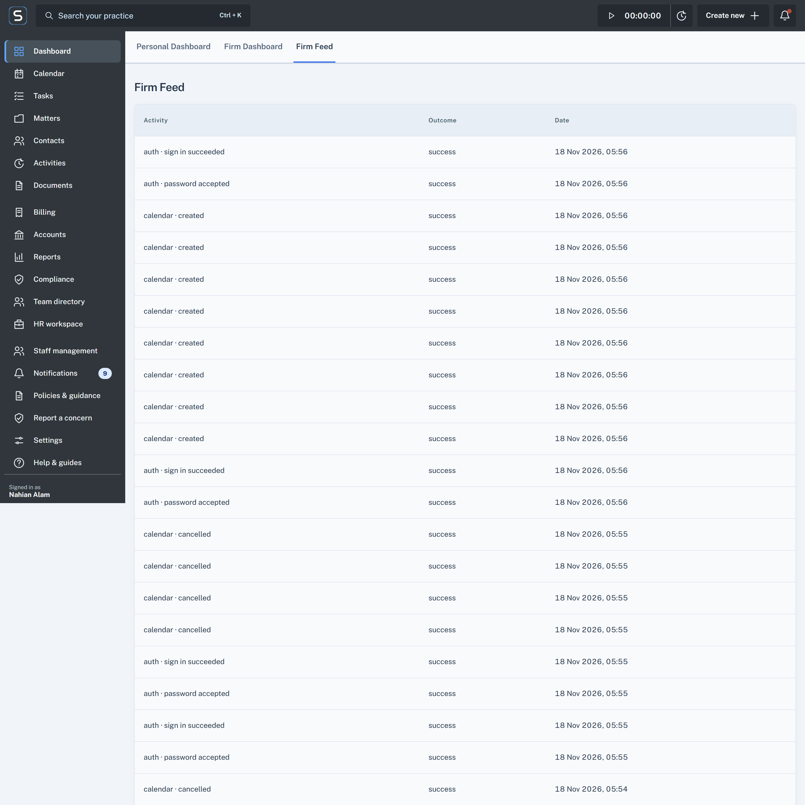
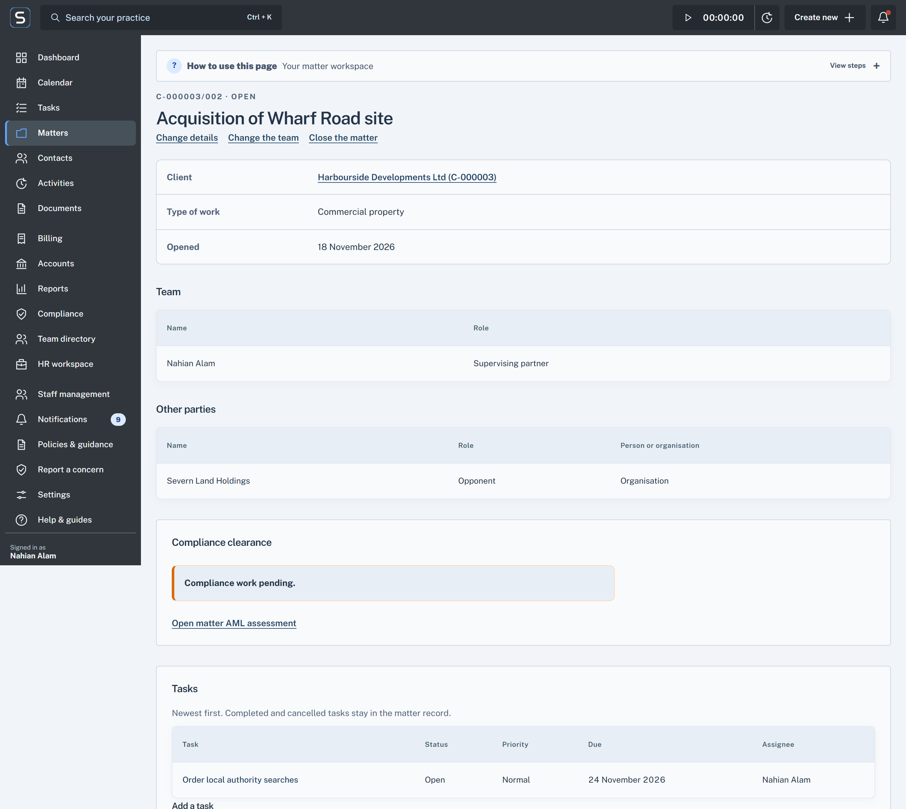
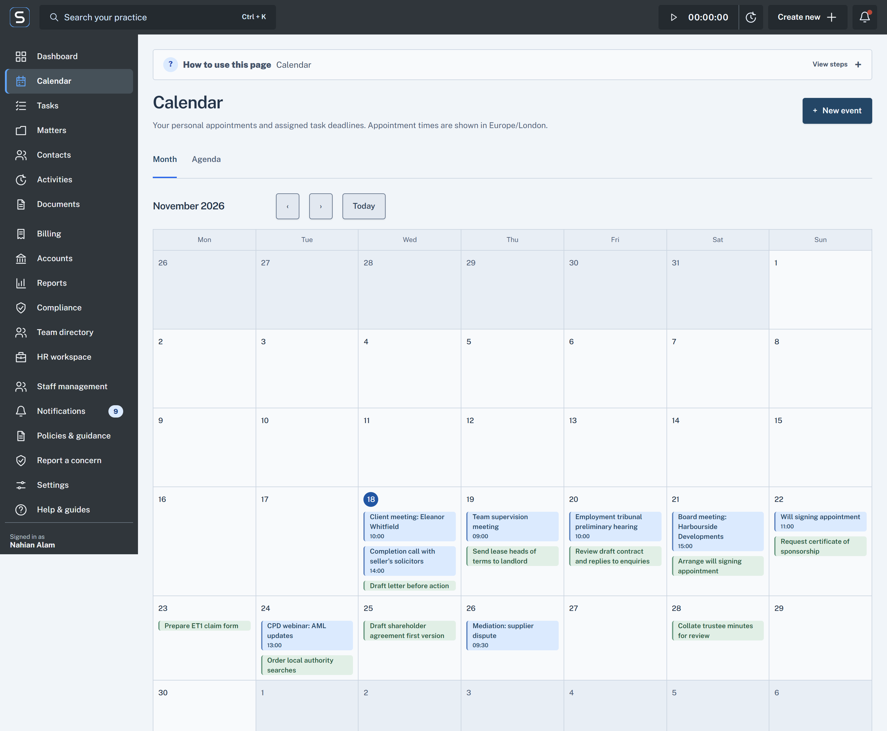
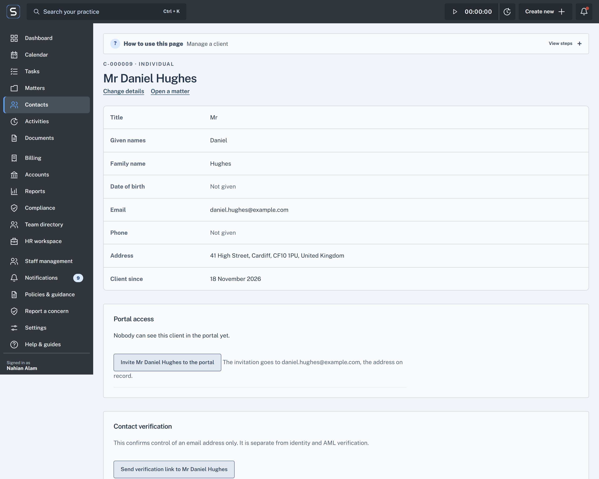
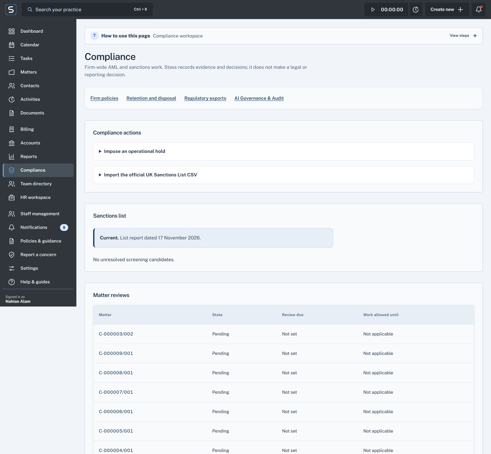
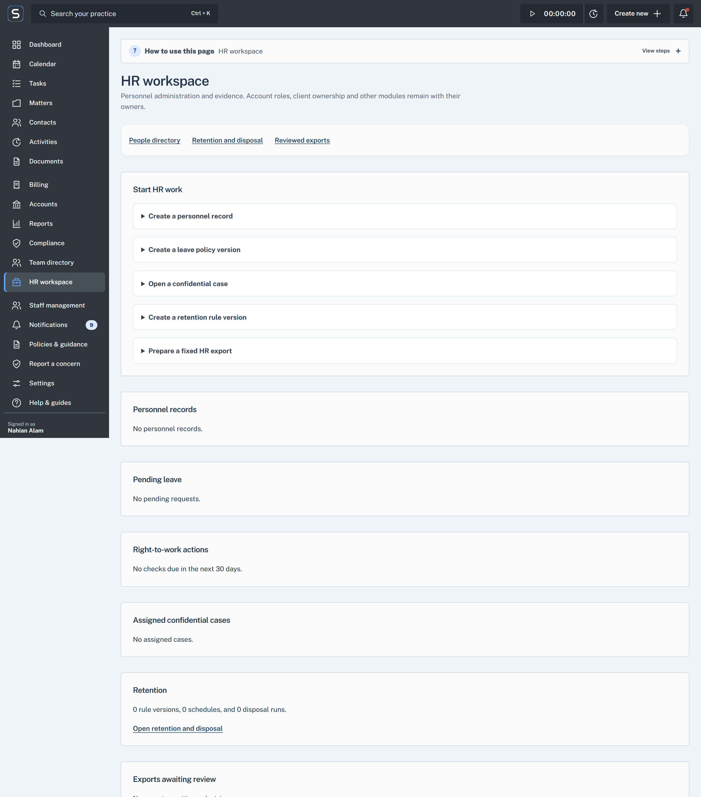
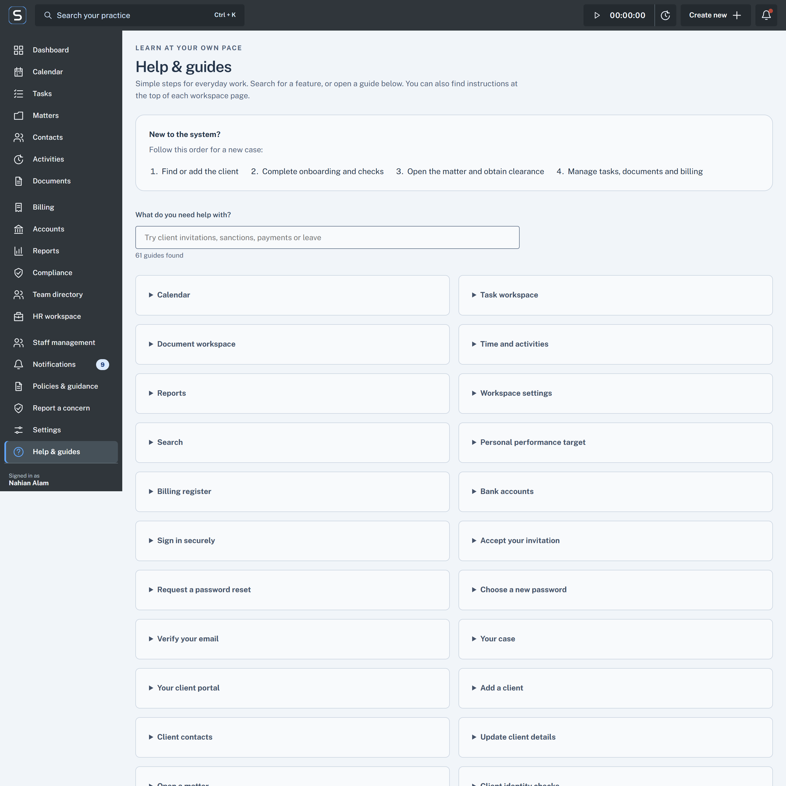

# Stass — Legal Practice Management System & Client Portal

<p align="center">
  
</p>

Stass is a comprehensive, security-first legal practice management system and dedicated client portal engineered for law firms operating in England and Wales. Designed to support solicitors, compliance officers, and practice managers, the platform unifies client onboarding, Solicitors Regulation Authority (SRA) conflict checking, matter administration, court calendar management, time recording, billing, AML and sanctions screening, HR governance, and controlled AI-assisted legal drafting into a single role-aware workspace.

---

## System Interface Gallery

<sub>Click any screenshot to open the full-length page.</sub>

### Practice Dashboards & Operational Activity Feed
<table><tr>
<td valign="top" width="50%"></td>
<td valign="top" width="50%"></td>
</tr></table>
<p align="center">
  <a href="Assets/03-firm-feed.png"></a>
</p>

- **Fee Earner Personal Dashboard:** Tracks active daily matters, personal billable hour targets versus actuals, urgent tasks due today, upcoming client appointments, and personal financial contributions.
- **Firm-Wide Executive Dashboard:** Aggregates practice-wide financial metrics including draft bills, issued fee notes, total credited amounts, and aggregate billable hours recorded across all practice fee earners.
- **Real-Time Firm Activity Feed:** An audited chronological feed capturing authentication events, document access, calendar updates, and workflow state transitions across the firm.

### Matter & Case Administration
<table><tr>
<td valign="top" width="50%"></td>
<td valign="top" width="50%"><a href="Assets/07-matter-detail.png"></a></td>
</tr></table>

- **Matters Register:** Filterable index of all active, open, pending, and closed legal matters categorized by matter type (Commercial Property, Litigation, Immigration, Wills & Probate, Corporate) with supervising solicitor tags.
- **Matter Detail Workspace:** Full matter workspace detailing client references, supervising partners, fee earner allocations, opposing parties, compliance clearance gates, time logs, and linked legal documents.

### Court Calendaring & Task Management
<table><tr>
<td valign="top" width="50%"><a href="Assets/04-calendar.png"></a></td>
<td valign="top" width="50%"></td>
</tr></table>

- **Legal Calendar & Hearing Schedule:** Time-zoned calendar tracking court dates, preliminary hearings, client consultations, and statutory filing deadlines with agenda drill-down views.
- **Matter-Linked Task Management:** Assigns priority-graded tasks (Urgent, High, Normal, Low) across matter teams with strict statutory limitation date tracking and completion audits.

### Client Management & Secure Client Portal
<table><tr>
<td valign="top" width="50%"></td>
<td valign="top" width="50%"><a href="Assets/09-client-detail.png"></a></td>
</tr></table>
<p align="center">
  
</p>

- **Client Directory & Intake:** Unified CRM repository separating individual and organizational clients with conflict check clearance histories and Companies House verification links.
- **Client Detail Management:** Manages contact profiles, associated matters, billing arrangements, and automated client portal invitation workflows.
- **Dedicated Secure Client Portal:** Independent, isolated web interface for clients to review shared matter updates, upload requested identity documents, sign engagement agreements, and review billing statements without accessing internal firm infrastructure.

### Regulatory Compliance, AML & Sanctions Screening
<table><tr>
<td valign="top" width="50%"><a href="Assets/10-compliance.png"></a></td>
<td valign="top" width="50%"></td>
</tr></table>

- **Compliance Workspace:** Centralized AML, sanctions screening, and regulatory export tools. Directly integrates with the official UK Sanctions List CSV to perform automated entity screening and enforce operational legal holds.
- **Confidential Concern Reporting:** Protected reporting workflow allowing fee earners to report suspected AML, terrorist financing, or professional conduct risks directly to the Nominated Officer with full confidentiality protection.

### Firm Governance, Policies & Interactive Knowledge Base
<table><tr>
<td valign="top" width="50%"><a href="Assets/11-hr-workspace.png"></a></td>
<td valign="top" width="50%"></td>
</tr></table>
<p align="center">
  <a href="Assets/15-help-and-guides.png"></a>
</p>

- **HR Administration:** Private personnel records, staff leave tracking, lifecycle checks, confidential internal cases, and audited HR retention schedules.
- **Practice Policies & Guidance:** Version-controlled practice policies (Anti-Money Laundering, SRA Code of Conduct, GDPR compliance) requiring partner approval and mandatory staff read-acknowledgment logging.
- **Interactive Knowledge Base:** 61 in-app interactive guides providing step-by-step instructions for fee earners, compliance officers, and administrative staff.

---

## Key Capabilities

- **SRA Regulatory Alignment:** Built around the specific regulatory compliance requirements of the Solicitors Regulation Authority (SRA) for law firms in England and Wales.
- **Client Money & Accounting Isolation:** Strict separation of client trust funds from office operational accounts with dual-approval rules on client account disbursements.
- **Automated Sanctions Screening:** Continuous background and point-of-intake screening of all client names and corporate entities against the official UK Sanctions List.
- **Client Portal Isolation:** Complete boundary enforcement ensuring external clients can only view records explicitly published to their portal account.
- **Encrypted Document Storage:** All uploaded legal documents and evidence files undergo ClamAV malware scanning and envelope encryption in S3-compatible object storage.
- **AI-Assisted Legal Drafting Controls:** Provider-neutral drafting assistants operating within strict matter boundaries with mandatory redaction, citation checking, and human-in-the-loop solicitor review.

---

## Technical Stack

- **Frontend Interface:** Next.js 16, React 19, TypeScript, Tailwind CSS, Lucide Icons
- **Backend Architecture:** NestJS 12, TypeScript, Zod Schema Validation
- **Database Engine:** PostgreSQL with Kysely Type-Safe SQL Query Builder
- **Document Management:** S3-Compatible Object Storage (SeaweedFS), Envelope Encryption, ClamAV Antivirus
- **Testing & Quality Assurance:** Vitest, Playwright (End-to-End browser tests), Axe-Core (WCAG 2.1 AA Accessibility)
- **Email Infrastructure:** Mailpit (Development), SMTP Integration (Production)

---

## System Architecture

```text
+-------------------------------------------------------------+
|                 Next.js Web Application                     |
|  - Staff Practice Workspace (Next.js 16 / React 19)         |
|  - Isolated Client Portal (Separate Authentication Domain)   |
|  - Role-Based Dynamic Navigation & WCAG 2.1 AA UI           |
+------------------------------+------------------------------+
                               | HTTPS / JSON API
+------------------------------v------------------------------+
|                   NestJS Backend API                        |
|  - Role-Based Access Control (RBAC) & Permission Guards     |
|  - Matter Workflow & SRA Compliance Rules Engine            |
|  - Time Recording, Disbursements & Client Accounting        |
|  - UK Sanctions List Ingestion & Match Verification         |
+---------------+--------------+--------------+---------------+
                |              |              |
+---------------v--+    +------v-------+   +--v---------------+
|    PostgreSQL    |    |  SeaweedFS   |   | ClamAV & Mailer  |
|  - Kysely ORM    |    |  - S3-Store  |   |  - File Antivirus|
|  - Audit Chains  |    |  - Encrypted |   |  - Notification  |
|  - Tenant Bounds |    |    Documents |   |    Dispatch      |
+------------------+    +--------------+   +------------------+
```

---

## Core Engineering Principles

- **Security & Data Confidentiality:** Granular role-based permissions ensure fee earners only access matters to which they are assigned or possess supervisory rights over.
- **Audit Immutability:** Sensitive operational changes, document accesses, and compliance decisions are preserved in append-only audit logs that cannot be truncated.
- **Zero Open-Source Leaks:** All proprietary business logic, statutory workflows, and firm configurations remain secure within private execution boundaries.

---

## Intellectual Property Notice

This repository serves exclusively as a portfolio demonstration. The underlying source code, configuration files, and proprietary legal workflow logic remain strictly confidential and are not distributed as open-source software. Unauthorized reproduction, modification, or redistribution of any materials within this repository is strictly prohibited.

All rights reserved.
